# desk-widgets

Desktop widgets for [Quickshell](https://quickshell.org) on Wayland. Frosted-glass cards (or Catppuccin, Gruvbox, Nord and more) that sit on the wallpaper layer below every window, so they never get in the way. Drop a file in a folder to turn a widget on, move it out to turn it off.

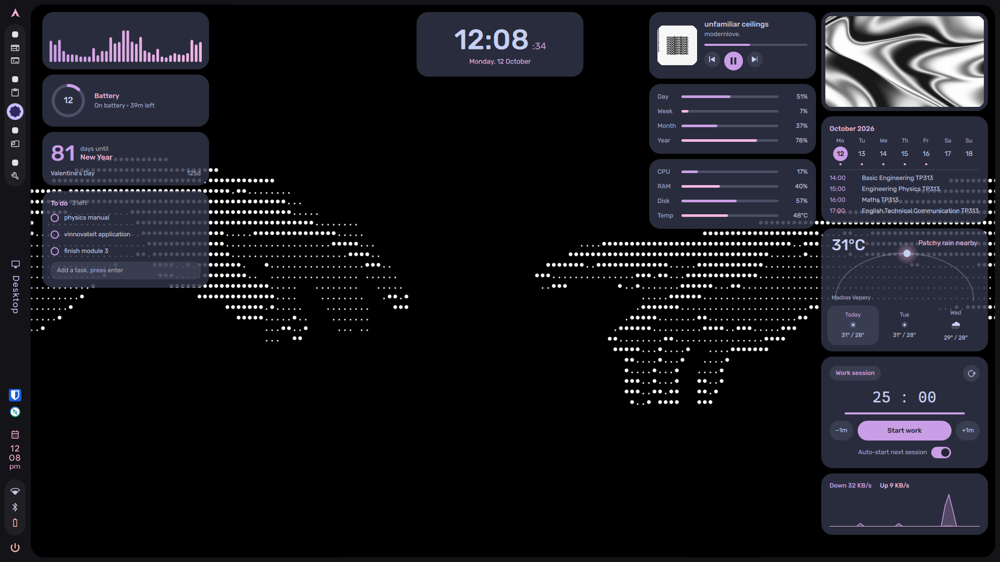

## Widgets

| | | |
|:--:|:--:|:--:|
| 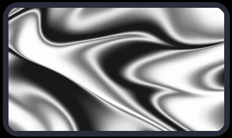<br>**Photo frame** | 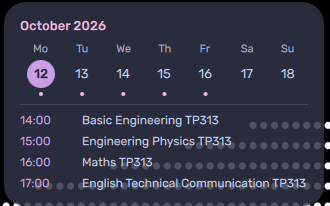<br>**Calendar** | 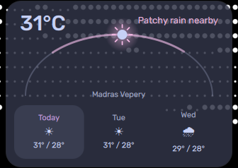<br>**Weather** |
| 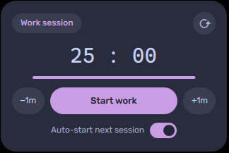<br>**Pomodoro** | 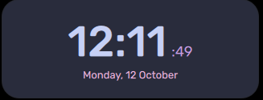<br>**Clock** | 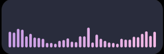<br>**Audio visualiser** |
| 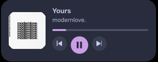<br>**Now playing** | 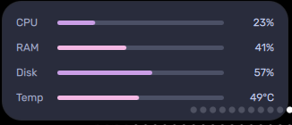<br>**System stats** | 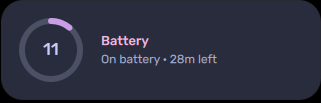<br>**Battery** |
| 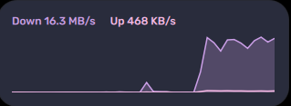<br>**Network speed** | 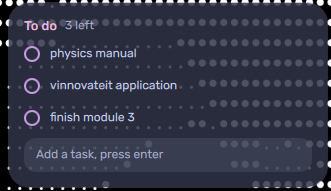<br>**To-do** | 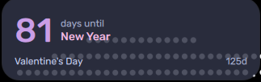<br>**Countdown** |
| 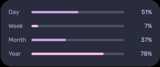<br>**Progress** | | |

| Widget | File | What it does | Needs |
|---|---|---|---|
| Photo frame | `10-photo.qml` | Cycles through `~/Pictures/desk-widgets`, click to skip | `shuf` |
| Calendar | `20-calendar.qml` | Week strip and agenda from iCal feeds (Google Calendar works) | `python`, `python-dateutil` |
| Weather | `30-weather.qml` | Current weather and 3 day forecast from wttr.in, no API key | `curl` |
| Pomodoro | `40-pomodoro.qml` | Work / break timer with desktop notifications | `libnotify` |
| Clock | `clock.qml` | Big clock with seconds and date | |
| Audio visualiser | `audio-vis.qml` | Bars that react to whatever is playing | `cava` |
| Now playing | `now-playing.qml` | Track, progress and controls for any MPRIS player | |
| System stats | `system-stats.qml` | CPU, RAM, disk and temperature | |
| Battery | `battery.qml` | Charge ring, plugged-in state, time left | `upower` |
| Network speed | `net-speed.qml` | Live down / up graph | |
| To-do | `todo.qml` | Click to tick, hover for × to delete, saved between restarts | |
| Countdown | `countdown.qml` | Days left until dates you list | |
| Progress | `progress.qml` | How far through the day, week, month and year | |

## Install

On Arch:

```sh
sudo pacman -S quickshell git adwaita-fonts ttf-material-symbols-variable
sudo pacman -S cava python-dateutil upower libnotify curl   # only what the widgets you use need
git clone https://github.com/YOUR_USER/desk-widgets ~/.config/quickshell/desk-widgets
qs -c desk-widgets
```

If `quickshell` isn't in your repos, use `quickshell-git` from the AUR.

Start it with your session, for example in Hyprland: `exec-once = qs -c desk-widgets`.

Text uses Adwaita Sans (an Inter cut, the closest open match to SF Pro) and icons come from Material Symbols Rounded. Set `font` in `settings.json` to use another text font.

## Turning widgets on and off

Everything in `active/` is shown, everything in `inactive/` is not. Move a `.qml` file from one folder to the other and the desktop updates live. Delete the ones you'll never use.

Widgets stack in file name order, so prefix with numbers to control the order. Files without a prefix go to the bottom.

Each widget keeps its settings as plain properties at the top of its file (city for weather, work length for pomodoro, bar count for the visualiser, and so on).

## Placing widgets

By default everything in `active/` stacks in the top right. To put a widget somewhere else, move it into a subfolder of `active/` named after the spot you want. Make the folder if it isn't there. Changes show up live.

```
top-left      top-center      top-right
center-left   center          center-right
bottom-left   bottom-center   bottom-right
```

Examples, run from the repo folder:

```sh
# clock in the top left
mkdir -p active/top-left && mv inactive/clock.qml active/top-left/

# audio visualiser along the bottom
mkdir -p active/bottom-center && mv inactive/audio-vis.qml active/bottom-center/

# several info widgets down the left side
mkdir -p active/center-left
mv inactive/system-stats.qml inactive/battery.qml inactive/todo.qml active/center-left/

# move a widget to another zone
mv active/top-left/clock.qml active/bottom-right/

# back to the default zone (top right)
mv active/top-left/clock.qml active/

# turn it off
mv active/top-left/clock.qml inactive/
```

A layout can end up looking like this:

```
active/
  10-photo.qml                top-right (default)
  20-calendar.qml             top-right
  top-left/
    10-clock.qml
    20-now-playing.qml
  bottom-left/
    10-progress.qml
  bottom-center/
    audio-vis.qml
```

Widgets sit on a grid like macOS: small (1×1), medium (2×1) and large (2×2). Each widget picks its size with `size: "small"`, `"medium"` or `"large"` at the top of its file, and two small ones in a row share a line. Widgets in one zone stack top to bottom in file name order, so prefix names with numbers to reorder them. When a stack reaches the bottom of the screen it wraps into a new column beside it. Folder names must match the zone names exactly (lowercase, hyphenated) or the widgets in them won't show.

### Settings

At the top of `shell.qml`:

| Setting | What it does |
|---|---|
| `defaultZone` | Where files directly in `active/` go |
| `margin` | Space from the screen edge |
| `insetTop` `insetBottom` `insetLeft` `insetRight` | Extra room for a bar or dock on that edge. Set it to the bar's size in px so widgets stay clear of it |

For example, with a 58px bar on the left, `insetLeft: 58` keeps the left zones off it.

## Themes

Settings live in `~/.config/desk-widgets/settings.json`, written with the defaults on first run. Edits apply live.

```json
{
  "theme": "glass",
  "mode": "auto",
  "opacity": 1,
  "font": "",
  "blur": true
}
```

| Setting | What it does |
|---|---|
| `theme` | A file name from `themes/` without `.json`: `glass` (default), `catppuccin-mocha`, `catppuccin-macchiato`, `catppuccin-frappe`, `catppuccin-latte`, `gruvbox`, `nord`, `tokyo-night`, `rose-pine`, `caelestia` |
| `mode` | `auto` follows your desktop's light / dark preference (`gsettings` color-scheme), or force `light` / `dark`. Themes with only one palette ignore it |
| `opacity` | Multiplies card opacity. Raise it (e.g. `2`) if your compositor doesn't blur behind the widgets |
| `font` | Overrides the theme's font |
| `blur` | On Hyprland, blur behind the cards (see below) |

`caelestia` follows the colours [caelestia](https://github.com/caelestia-dots/shell) generates from your wallpaper. To make your own theme, copy a file in `themes/` and change the colours.

**Blur.** The glass look needs the compositor to blur behind the cards. On Hyprland desk-widgets does this itself: at start it adds a layer rule for its namespace (`desk-widgets`) with `hyprctl eval`, and adds it again whenever Hyprland reloads its config. Nothing is written to your Hyprland config, and the rule goes away with the next config reload once desk-widgets stops. Set `"blur": false` in `settings.json` to turn it off.

On other compositors, add a blur rule for the layer namespace `desk-widgets` yourself, or raise `opacity` so the cards stay readable without it.

## Setup notes

**Calendar.** Put your iCal links in `~/.config/desk-widgets/calendars.txt`, one per line. For Google Calendar use *Settings → your calendar → Secret address in iCal format*. Treat the link like a password. It is read only from that file and never printed, logged or stored in this repo.

**To-do.** The input box needs keyboard focus. Click it and type. If your compositor doesn't give focus to bottom layer surfaces, typing won't work.

**Audio visualiser.** It starts its own `cava` and reads your default audio output, so there is nothing to configure.

## Writing your own widget

Add a file to `active/` and import the shared bits:

```qml
import QtQuick
import qs.core

Card {
    size: "small"
    Label { text: "Hello" }
    Txt { anchors.centerIn: parent; text: "world"; font.pixelSize: 28; font.weight: Font.DemiBold }
}
```

`core/` has `Card` (sizes, glass), `Txt`, `Label` (small caps heading), `Icon` (Material Symbols by name), `Ring`, `IconButton`, `RoundImage`, plus the `Theme`, `Settings` and `Time` singletons. Because it imports `qs.core`, the file works from any zone folder. Colours come from `Theme` by role (`Theme.text`, `Theme.textDim`, `Theme.accent`, `Theme.surface`, `Theme.red` ...), so a new widget matches every theme.

## Layout of the repo

```
shell.qml       starts one stack per screen position
core/           theme, settings, zones and shared components
themes/         colour palettes, one JSON file per theme
active/         widgets that are shown
inactive/       widgets that are available
scripts/        helpers the widgets call (gcal.py, stats.sh, net.sh)
screenshots/    images used in this readme
```

## License

MIT
