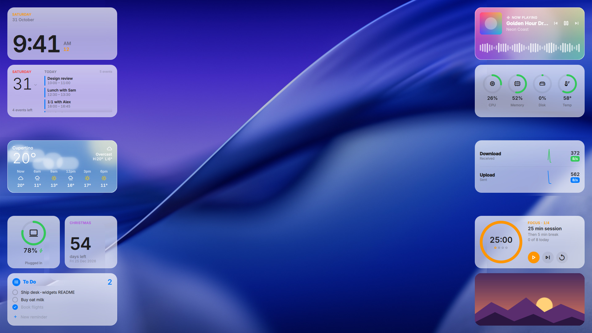
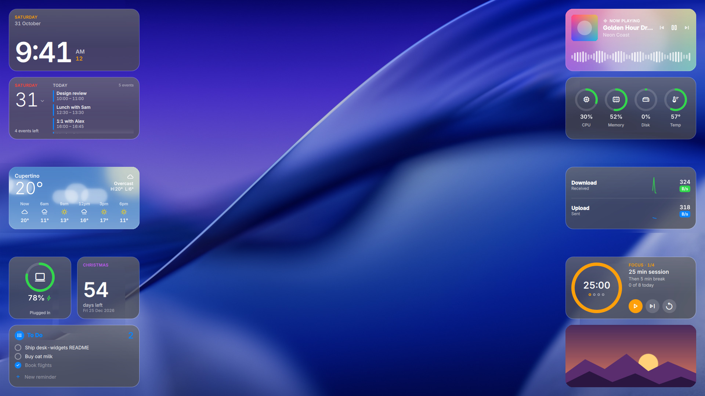
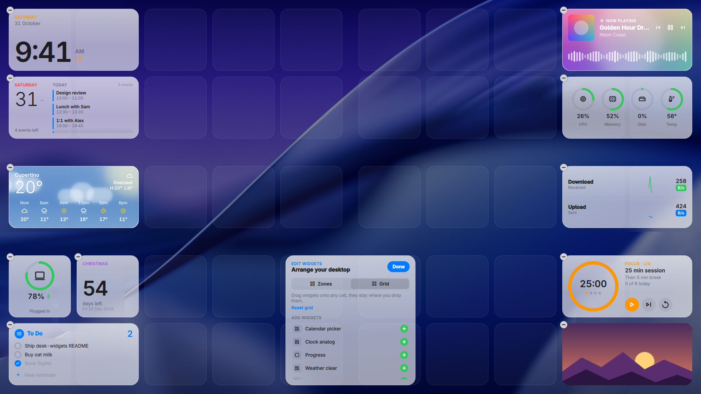
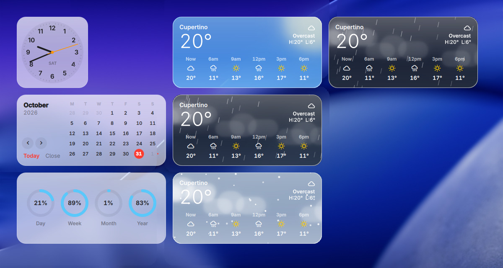
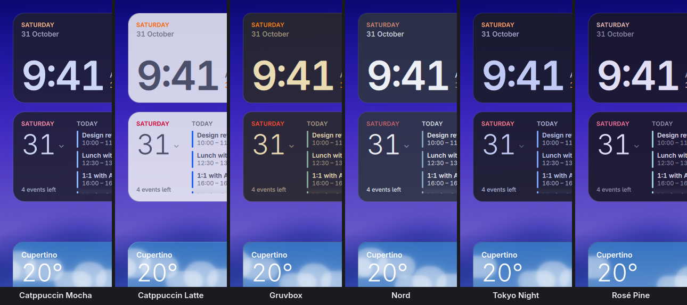

# desk-widgets
macOS-style desktop widgets for Hyprland and other Wayland compositors, built with [Quickshell](https://quickshell.org)



<p>
  
  
</p>

<sub>Wallpaper: macOS Tahoe (dark) by Apple, via <a href="https://512pixels.net/projects/default-mac-wallpapers-in-5k/">512 Pixels</a>. Calendar, music and to-do in the screenshots are sample data.</sub>

Frosted-glass widgets that sit on your wallpaper, below every window, like the widgets on a Mac desktop. They come in small, medium and large sizes on a grid, follow your light / dark preference, and can be dragged around in an edit mode. Ten themes, from the default macOS glass to Catppuccin, Gruvbox, Nord, Tokyo Night and Rosé Pine.

- **14 widgets**: clock, calendar, weather, music, system stats, network, battery, to-do, Obsidian notes, countdown, pomodoro, photo frame, now playing and day / year progress
- **Real blur on Hyprland**, set up automatically with nothing written to your Hyprland config
- **Edit mode** to drag widgets, add and remove them, and switch between zone and grid placement
- **Plain QML files**: a widget is one `.qml` file, and turning it on or off is moving that file between two folders
- **No accounts or API keys**: weather comes from wttr.in, the calendar from any iCal link

## Widgets



| Widget | File | What it shows | Needs |
| --- | --- | --- | --- |
| Clock | `clock.qml` | Big digital time and date, or an analog face with `style: "analog"` | |
| Calendar | `20-calendar.qml` | Today's whole timetable, scrollable. Click the date for a month picker | `python`, `python-dateutil` |
| Weather | `30-weather.qml` | Now, the next hours and (large) 3 days, over a moving sky: sun, stars, clouds, rain, snow, fog, lightning | `curl` |
| Music | `audio-vis.qml` | Cover, title and artist over a blurred cover, a live waveform, and previous / play / next | `cava` for the waveform |
| Now playing | `now-playing.qml` | Cover, track, progress bar and controls for any MPRIS player | |
| System stats | `system-stats.qml` | CPU, memory, disk activity (time spent on I/O) and temperature as rings | |
| Network | `net-speed.qml` | Download and upload speed with live sparklines | |
| Battery | `battery.qml` | Charge ring, charging state and time left | `upower` |
| To-do | `todo.qml` | A Reminders-style list: click a circle to tick, × to delete, type to add | |
| Notes | `notes.qml` | Your Obsidian vault like the macOS Notes widget: the notes you edited last with a date and preview, or one pinned note. Click to open in Obsidian, the pencil starts a new note. Read only | `python`, Obsidian |
| Countdown | `countdown.qml` | Days left until an event you type in | |
| Pomodoro | `40-pomodoro.qml` | Focus timer with short and long breaks, rounds, a daily goal, skip and reset. Click the ring to start, scroll it to add or take off minutes. Survives suspend and restarts | `libnotify`, `pipewire` for the sound |
| Photo frame | `10-photo.qml` | Cycles through the pictures in `~/Pictures/desk-widgets`, click to skip | `shuf` |
| Progress | `progress.qml` | How far through the day, week, month and year you are | |
| Edit Widgets | `edit-widgets.qml` | Turns on edit mode while it's in `active/` | |

## Install

Needs Quickshell 0.3 or newer with Qt 6.8+, and a Wayland compositor with the layer-shell protocol (Hyprland, Sway, niri, river, ...). On Arch:

```bash
sudo pacman -S quickshell git adwaita-fonts ttf-material-symbols-variable
```

Only what the widgets you use need:

```bash
sudo pacman -S python-dateutil curl cava upower libnotify
```

If `quickshell` isn't in your repos, use `quickshell-git` from the AUR. Then:

```bash
git clone https://github.com/alon3wolfus/desk-widgets ~/.config/quickshell/desk-widgets
qs -c desk-widgets
```

Start it with your session. Hyprland with the Lua config:

```lua
hl.exec_cmd("qs -c desk-widgets")
```

Hyprland with hyprlang: `exec-once = qs -c desk-widgets`. Anything else: run `qs -c desk-widgets` from your autostart. You can keep the clone anywhere and run `qs -p /path/to/desk-widgets` instead.

## Turning widgets on and off

Everything in `active/` is shown, everything in `inactive/` is not. Move a `.qml` file from one folder to the other and the desktop updates live. Editing a widget file reloads just that widget.

```bash
cd ~/.config/quickshell/desk-widgets
mv inactive/progress.qml active/        # turn progress on
mv active/top-left/battery.qml inactive/  # turn battery off
```

## Edit mode

Move `inactive/edit-widgets.qml` into `active/` and the desktop goes into edit mode, like *Edit Widgets* on macOS. The widgets rise above your windows and you can:

- **drag** any widget to place it
- **remove** one with the − in its corner (its file moves to `inactive/`)
- **add** one from the list in the Edit Widgets card (its file moves to `active/`)
- switch between **Zones** and **Grid** placement

Press **Done** to leave. That moves `edit-widgets.qml` back to `inactive/`; move it into `active/` again to rearrange later. The Edit Widgets card floats above everything and can be moved by its header.

```bash
mv ~/.config/quickshell/desk-widgets/inactive/edit-widgets.qml ~/.config/quickshell/desk-widgets/active/
```

## Placing widgets

There are two ways to place widgets, switched in edit mode. The choice and the grid positions are saved in `~/.config/desk-widgets/layout.json`.

**Zones** (the default) stacks widgets in nine areas of the screen, chosen by folder:

```
active/top-left      active/top-center      active/top-right
active/center-left   active/center          active/center-right
active/bottom-left   active/bottom-center   active/bottom-right
```

Files directly in `active/` go to `top-right`. Widgets in one zone stack top to bottom in file name order, so prefix names with numbers (`10-photo.qml`, `20-calendar.qml`) to reorder them. Two small widgets in a row share a line, and a stack that reaches the bottom of the screen wraps into a new column. In edit mode, dropping a widget into an area moves its file into that zone's folder.

**Grid** puts every widget on its own cell of a screen-wide grid and keeps it where you drop it. Like macOS, the left half of the columns lines up from the left edge and the right half from the right edge, so widgets hug the screen edges and the leftover space sits in the middle. A widget dropped across the middle line is centred on the screen. Dropping on a taken cell picks the nearest free one, and *Reset grid* starts over from the zone layout.

Sizes follow macOS: small is 1×1 cell (170 px), medium 2×1, large 2×2. Each widget sets its size with `size: "small"`, `"medium"` or `"large"` at the top of its file. The calendar and weather have extra content at `large`.

### Screen edges and bars

Set these at the top of `shell.qml`:

| Setting | What it does |
| --- | --- |
| `defaultZone` | Where files directly in `active/` go (`top-right`) |
| `margin` | Space between widgets and the screen edge (24 px) |
| `insetTop` `insetBottom` `insetLeft` `insetRight` | Extra room for a bar or dock on that edge, in px |

For example, with a 60 px bar on the left, `insetLeft: 60` keeps widgets off it.

## Themes



Settings live in `~/.config/desk-widgets/settings.json`, written with the defaults on first run. Changes apply live.

```json
{
  "theme": "glass",
  "mode": "auto",
  "opacity": 1,
  "font": "",
  "blur": true
}
```

| Setting | What it does |
| --- | --- |
| `theme` | `glass` (default), `catppuccin-mocha`, `catppuccin-macchiato`, `catppuccin-frappe`, `catppuccin-latte`, `gruvbox`, `nord`, `tokyo-night`, `rose-pine` or `caelestia` |
| `mode` | `auto` follows your desktop's light / dark preference (the `color-scheme` gsetting), or force `light` / `dark`. Themes with one palette ignore it |
| `opacity` | Multiplies card opacity. Raise it (e.g. `1.4`) if your compositor doesn't blur behind the widgets |
| `font` | Overrides the text font, e.g. `"Inter"` |
| `blur` | On Hyprland, blur the wallpaper behind the cards (see below) |

`glass` is a frosted macOS look: light cards on a light desktop setting, darker frost on a dark one, so text stays readable on bright and dark wallpapers alike. `caelestia` follows the colours [caelestia](https://github.com/caelestia-dots/shell) generates from your wallpaper. To make your own theme, copy a file in `themes/` and change the colours; the file name is the theme name.

### Blur

The glass look needs the compositor to blur behind the cards. On Hyprland desk-widgets does it itself: at start it adds a layer rule for its namespace (`desk-widgets`) with `hyprctl eval`, and adds it again whenever Hyprland reloads its config. Nothing is written to your Hyprland config. Set `"blur": false` to turn it off.

On other compositors, add a blur rule for the layer namespace `desk-widgets` yourself, or raise `opacity` so the cards stay readable without it.

## Widget settings

Each widget keeps its options as properties at the top of its file. Edit them and the widget reloads.

| Widget | Property | Default | What it does |
| --- | --- | --- | --- |
| Clock | `style` | `"digital"` | `"analog"` for a small watch face |
| | `use24h` | `false` | 24-hour time |
| | `showSeconds` | `true` | Seconds next to the time |
| Weather | `city` | `""` | `"Chennai"`, `"51.5,-0.12"`, `"LHR"`; empty guesses from your IP |
| | `imperial` | `false` | °F instead of °C |
| | `sky` | `true` | The moving sky background; `false` for a plain glass card |
| | `size` | `"medium"` | `"large"` adds a 3-day forecast |
| Calendar | `size` | `"medium"` | `"large"` adds this month's grid |
| | `revertAfter` | `300000` | Milliseconds before a picked day goes back to today |
| Music | `bars` | `44` | Bars in the waveform |
| Pomodoro | `focusMinutes` | `25` | Length of a focus session |
| | `shortBreakMinutes` | `5` | Break after each focus session |
| | `longBreakMinutes` | `15` | Break after the last round |
| | `rounds` | `4` | Focus sessions before a long break, shown as dots; `0` for no long breaks |
| | `autoStartBreaks` | `true` | Start a break as soon as focus ends |
| | `autoStartFocus` | `false` | Start focus as soon as a break ends |
| | `dailyGoal` | `8` | Focus sessions a day; `0` just counts them |
| | `notify` | `true` | Desktop notification when a timer ends |
| | `sound` | freedesktop `complete.oga` | Sound played when a timer ends, any file `pw-play` or `paplay` can play; `""` for silent |
| | `scrollStep` | `1` | Minutes added or taken off per scroll notch |
| | `use24h` | `false` | 24-hour "Ends at" time |
| Notes | `vault` | `""` | Vault folder; empty uses the vault Obsidian has open |
| | `note` | `""` | Pin one note, relative to the vault (`"Ideas/Todo.md"`); empty lists recent notes |
| | `folder` | `""` | Only notes in this folder of the vault |
| | `exclude` | `[]` | Folders to leave out, e.g. `["Templates", "Archive"]` |
| | `newNoteFolder` | `""` | Where the pencil creates notes; empty lets Obsidian decide |
| | `refreshSeconds` | `30` | How often the vault is read |
| | `size` | `"medium"` | `"small"` shows one note, `"large"` a longer list |
| | `use24h` | `false` | 24-hour times on today's notes |
| Photo frame | `folder` | `~/Pictures/desk-widgets` | Where the pictures are |
| | `intervalMinutes` | `5` | Minutes per picture |
| Network | `samples` | `40` | Seconds of history in the sparklines |

### Pomodoro

The settings sit at the top of `40-pomodoro.qml`:

```qml
property int focusMinutes: 25
property int shortBreakMinutes: 5
property int longBreakMinutes: 15
property int rounds: 4                 // focus sessions before a long break, 0 for never
property bool autoStartBreaks: true
property bool autoStartFocus: false
property int dailyGoal: 8              // focus sessions a day, 0 just counts them
property bool notify: true
property string sound: "/usr/share/sounds/freedesktop/stereo/complete.oga"   // "" for silent
property int scrollStep: 1             // minutes per scroll notch
property bool use24h: false
```

- **Play / pause**: the orange button, or click the ring
- **Skip**: moves to the next phase without counting the session
- **Reset**: restarts the current timer. Press it again on a fresh timer to go back to round 1
- **Scroll on the ring**: adds or takes off `scrollStep` minutes, even while it runs
- The dots under the time are the rounds; after the last one comes the long break
- "Ends at" shows when the running timer will finish, and the count under it starts over at midnight
- The timer follows the wall clock and is saved, so suspend, a shell restart or editing the settings doesn't lose it. A timer that ran out while the shell was off moves on to the next phase and waits

## Setup notes

**Calendar.** Put your iCal links in `~/.config/desk-widgets/calendars.txt`, one per line. For Google Calendar use *Settings → your calendar → Secret address in iCal format*. Treat the link like a password: it is read only from that file and never printed, logged or stored in this repo. Events sync every 15 minutes, from 31 days back to 120 days ahead.

**To-do.** Items are saved to `~/.local/share/desk-widgets/todo.json`. Click the add row and type; Enter or + adds it.

**Notes.** Finds the vault Obsidian has open on its own (from `~/.config/obsidian/obsidian.json`, Flatpak too); set `vault` for another one. It reads the Markdown files directly, so it works with any sync (Obsidian Sync, LiveSync, Git, Syncthing) and never writes to the vault. Titles come from the first `# heading` or the file name; previews skip frontmatter, embeds and comments, and show wikilinks as plain text. Clicks open `obsidian://` links, so Obsidian must be installed.

**Countdown.** Type an event name, Enter, then the date as `ddmmyyyy`, Enter. It clears itself once the day has passed.

**Music.** The waveform starts its own `cava` and reads your default audio output. The track comes from MPRIS, so Spotify, browsers, mpv and most players work.

**Weather** uses [wttr.in](https://wttr.in), no key or account.

## FAQ

**The widgets don't react to clicks near the screen edges (caelestia).** caelestia catches clicks in a band along the screen edges on empty workspaces, so you can drag its panels open. The band is as wide as its largest panel drag threshold (80 px by default) and sits above the widgets. Lower the thresholds to about 20 in caelestia's settings, or add `"dragThreshold": 20` to `dashboard`, `launcher`, `session` and `sidebar` in `~/.config/caelestia/shell.json`.

**I can't see the widgets.** They live on the bottom layer, under every window. Switch to an empty workspace. Run `qs log -c desk-widgets` to see errors.

**A widget I moved into `active/` doesn't show.** Check the file name ends in `.qml` and the folder name is one of the nine zones, lowercase and hyphenated. `qs log -c desk-widgets` shows QML errors with the line number.

**Can I use it without Hyprland?** Yes. Everything works on any compositor with layer-shell. Only the automatic blur is Hyprland-specific.

**Multiple monitors?** Widgets show on the primary screen.

## Writing your own widget

Add a file to `active/` and import the shared parts:

```qml
import QtQuick
import qs.core

Card {
    size: "small"
    Label { text: "Hello" }
    Txt { anchors.centerIn: parent; text: "world"; font.pixelSize: 28; font.weight: Font.DemiBold }
}
```

`core/` has `Card` (sizes and glass), `Txt`, `Label` (small caps heading), `Icon` (a [Material Symbols](https://fonts.google.com/icons) name), `Ring`, `IconButton` and `RoundImage`, plus the `Theme`, `Settings`, `Layout` and `Time` singletons. Colours come from `Theme` by role (`Theme.text`, `Theme.textDim`, `Theme.accent`, `Theme.surface`, `Theme.red` ...), so a new widget matches every theme. Because it imports `qs.core`, the file works from any zone folder.

## Layout of the repo

```
shell.qml       starts the desktop; screen margins and insets
core/           theme, settings, layout, the desktop surface and shared components
themes/         colour palettes, one JSON file per theme
active/         widgets that are shown, in zone folders
inactive/       widgets that are available
scripts/        helpers the widgets call (gcal.py, stats.sh, net.sh, notes.py)
docs/           images used in this readme
```

## Full reference

<details>
<summary><b>Everything desk-widgets does, in detail</b> (click to expand). Written to be complete, so you can also paste this README into an AI assistant and ask it how to do something.</summary>

### Overview

desk-widgets is a Quickshell config written in QML. `shell.qml` creates one full-screen, transparent layer-shell surface (namespace `desk-widgets`, bottom layer, exclusion mode ignore, keyboard focus on demand) that holds every widget. Its input mask covers only the widgets, so clicks on empty desktop go through. While edit mode is on, the surface moves to the top layer and takes all input.

Each widget is a `.qml` file whose root is a `Card`. The desktop lists `active/` and its nine zone folders, then reads and compiles each file itself with `Qt.createQmlObject` (Qt caches folder listings, so a file added while the shell runs would never load through a normal `Loader`). A file change rebuilds only that widget.

### Files and folders

| Path | What it is |
| --- | --- |
| `shell.qml` | Entry point. `defaultZone`, `margin`, `insetTop/Bottom/Left/Right` |
| `active/*.qml` | Shown widgets, in `defaultZone` |
| `active/<zone>/*.qml` | Shown widgets in that zone. Zones: `top-left`, `top-center`, `top-right`, `center-left`, `center`, `center-right`, `bottom-left`, `bottom-center`, `bottom-right` |
| `inactive/*.qml` | Available widgets |
| `themes/<name>.json` | Theme palettes |
| `scripts/gcal.py` | Fetches iCal feeds, prints JSON events |
| `scripts/stats.sh` | CPU counters, memory, per-disk I/O time, uptime, temperature |
| `scripts/notes.py` | Reads an Obsidian vault, prints recent notes or one note as JSON |
| `scripts/net.sh` | Total bytes received and sent |
| `~/.config/desk-widgets/settings.json` | `theme`, `mode`, `opacity`, `font`, `blur` |
| `~/.config/desk-widgets/layout.json` | `mode` (`zones` or `grid`) and grid `positions` by file name |
| `~/.config/desk-widgets/calendars.txt` | iCal links, one per line, `#` comments |
| `~/.local/share/desk-widgets/todo.json` | To-do items |
| `~/.local/state/quickshell/by-shell/<id>/pomodoro.json` | Pomodoro phase, round, timer and today's count |
| `~/.cache/desk-widgets/` | Cached calendar feeds |

### layout.json

```json
{
  "mode": "grid",
  "positions": {
    "clock.qml": { "col": 0, "row": 0 },
    "30-weather.qml": { "col": 8, "row": 2 }
  }
}
```

Positions are keyed by file name, so a widget keeps its cell when its file moves between zone folders. Columns count from 0 at the left; the grid always has an even number of columns. Positions that no longer fit the screen or overlap another widget are moved to the nearest free cell. Widgets without a position get the free cell nearest to where their zone would put them.

### Theme files

A theme is either one palette or a `dark` and a `light` one:

```json
{
  "name": "My theme",
  "dark": {
    "surface": "#1c1c1e", "surfaceOpacity": 0.68,
    "raised": "#ffffff", "raisedOpacity": 0.14,
    "raisedHot": "#ffffff", "raisedHotOpacity": 0.22,
    "edge": "#ffffff", "edgeOpacity": 0.22,
    "sheen": 0.12, "frost": 0.16,
    "text": "#ffffff", "textDim": "#b3ffffff", "textFaint": "#73ffffff",
    "accent": "#0a84ff", "accent2": "#ff9f0a", "onAccent": "#ffffff",
    "red": "#ff453a", "orange": "#ff9f0a", "yellow": "#ffd60a", "green": "#32d74b",
    "blue": "#0a84ff", "purple": "#bf5af2", "pink": "#ff375f", "teal": "#64d2ff",
    "sans": "Adwaita Sans", "radius": 22
  }
}
```

`surface` is the card tint, `frost` a white haze over it, `sheen` the highlight across the top, `raised` the fill for tracks and buttons. Colours may carry alpha as `#AARRGGBB`. Missing keys fall back to Catppuccin Frappé. `{ "source": "caelestia" }` reads `~/.local/state/caelestia/scheme.json` instead.

### Hyprland blur rule

With `"blur": true`, on start and after every `configreloaded` event, desk-widgets runs:

```lua
hl.layer_rule({ name = "desk-widgets-blur", match = { namespace = "desk-widgets" }, blur = true, ignore_alpha = 0.05 })
```

The rule is named, so applying it again replaces it.

### Core components (`import qs.core`)

| Component | Properties |
| --- | --- |
| `Card` | `size` (`small` / `medium` / `large`), `pad` (16), `tinted` (skip the frost when painting your own background). Children go inside the padding |
| `Txt` | A `Text` with the theme font, colour and tabular numbers |
| `Label` | Small caps heading in `Theme.accent` |
| `Icon` | `name` (Material Symbols), `size`, `filled`, `color` |
| `Ring` | `value` 0–1, `tint`, `track`, `thickness`; set `width` |
| `IconButton` | `icon`, `size`, `fill` (`"transparent"` for a bare glyph), `ink`, signal `clicked` |
| `RoundImage` | `source`, `radius`, `blur` 0–1 |
| `Theme` | Colours by role, `sans`, `mono`, `icons`, `radius`, `unit` (170), `gap` (16), `wide` (356), `isDark` |
| `Settings` | The values from `settings.json` |
| `Layout` | `mode`, `positions`, `editing`, and `activate(path)`, `deactivate(path)`, `toZone(path, zone)` |
| `Time` | `now`, a minute-resolution clock |

A widget can declare `property string widgetPath` to be told its own file path, and `readonly property bool pinned: true` to float above the grid without taking a cell (the Edit Widgets card does both).

</details>

## License

[GPL-3.0](LICENSE). You can use, change and share desk-widgets; if you share a changed version, it has to stay under the GPL-3.0 with its source available.
